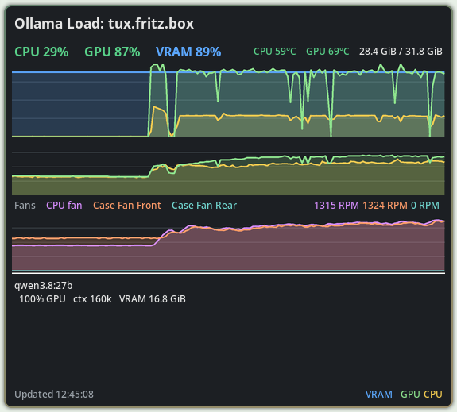
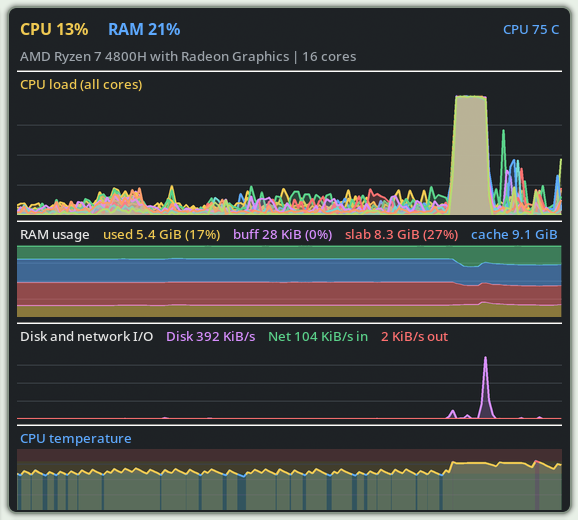

# ollama-load

A tiny monitor for an NVIDIA-backed Ollama server and a local operating-system
load dashboard. It allows monitoring my remote server and view it next to my
local CPU load. The goal was to have a small applet (inspired by xosview) that
I can run in my tiling window manager (hyprland) next to a coding session.

It consists of:

- `ollama_load_service.py`: periodically reads `nvidia-smi` and Ollama's
  `/api/ps`, keeps a short in-memory history, and serves JSON over HTTP.
- `ollama_load_gui.py`: a compact Tkinter window showing CPU load, GPU load,
  CPU/GPU temperatures, VRAM use, active models, GPU offload percentage,
  context size, fan speeds, and history graphs for load, temperature, and fans.
- `os-load.py`: a standalone local dashboard showing CPU model and core count,
  CPU and per-core load, memory usage, disk and network I/O, CPU temperature,
  and the most active processes.

The Ollama GUI window is 430 × 470 pixels by default. The OS load window is
430 × 720 pixels. The service uses only the Python standard library; the GUI
applications also require Tkinter and Pillow.

## Screenshots

### Ollama Load



### OS Load



## Install the service on the Ollama machine

```sh
sudo install -d -o root -g root /opt/ollama-load
sudo install -m 0755 ollama_load_service.py /opt/ollama-load/
sudo install -m 0644 ollama-load.service /etc/systemd/system/
sudo systemctl daemon-reload
sudo systemctl enable --now ollama-load.service
curl http://127.0.0.1:8765/health
```

The unit assumes Ollama runs as user `ollama`, as the standard Ollama service
does. Adjust `User` and `Group` if your installation differs.

To install the GUI applications for the current user without installing the
system service, run:

```sh
./install.sh --user
```

## Connect securely from your desktop

The service listens only on the server's loopback interface by default. Create
an SSH tunnel:

```sh
ssh -N -L 8765:127.0.0.1:8765 ollama-machine
```

Then start the Ollama GUI locally:

```sh
python3 ollama_load_gui.py
```

To start the standalone local OS monitor:

```sh
python3 os-load.py
```

It reads local Linux counters and does not connect to the Ollama service. Use
`--poll` to change its sample interval or `--graph-minutes` to change the graph
history, for example:

```sh
python3 os-load.py --poll 1 --graph-minutes 10
```

Tkinter is part of many Python installations. The GUI also uses Pillow for
alpha-composited graph fills. On Debian/Ubuntu, install both with
`sudo apt install python3-tk python3-pil` if necessary.

On Tk builds that support it, the GUI uses the window manager's color-key
transparency for its `#16191d` background. Tk does not expose per-pixel window
transparency on X11, so Linux window managers retain the opaque background.

You can use a different endpoint with:

```sh
python3 ollama_load_gui.py --url http://server:8765
```

The graph displays the latest five minutes by default. Change the time window
with `--graph-minutes`, for example `--graph-minutes 10`.

## Configuration

The GUI reads optional fan selections and labels from `~/.ollama-load.conf`.
Use the sensor IDs reported by the service, one per line:

```ini
fan1 = CPU fan
fan3 = Case Fan Front
fan4 = Case Fan Rear
```

When this file exists, only the listed fans are shown. Without it, all detected
fans are shown using their sensor labels. Fan speeds are read from Linux hwmon
`fan*_input` sensors and are included in both `fans` and the history returned by
`/api/status`.

The service accepts command-line switches or environment variables:

| Option | Environment | Default | Meaning |
| --- | --- | --- | --- |
| `--bind` | `OLLAMA_LOAD_BIND` | `127.0.0.1` | HTTP listen address |
| `--port` | `OLLAMA_LOAD_PORT` | `8765` | HTTP port |
| `--interval` | `OLLAMA_LOAD_INTERVAL` | `2` | Sample interval in seconds |
| `--history` | `OLLAMA_LOAD_HISTORY` | `300` | Samples retained in memory |
| `--ollama-url` | `OLLAMA_URL` | `http://127.0.0.1:11434` | Ollama base URL |

The GUI graphs display five minutes by default. Service history is kept in RAM
and intentionally resets when the service restarts.

If you expose the service directly on a trusted LAN, set
`OLLAMA_LOAD_BIND=0.0.0.0` and restrict port 8765 with the host firewall. You
can additionally set `OLLAMA_LOAD_TOKEN` in both the service and GUI; the GUI
then sends it as a bearer token. This is not encryption, so use Wireguard, SSH
or HTTPS on an untrusted network.

## JSON endpoint

`GET /api/status` returns the latest CPU/GPU/model data plus the history used by
the graphs. CPU load is read from `/proc/stat`; CPU temperature is read from
Linux thermal zones. `size_vram / size` is used to show the same useful idea as Ollama's
`PROCESSOR` column: `100% GPU` means fully GPU-resident; a lower value indicates
partial CPU offload. `context_length` is taken directly from Ollama `/api/ps`.

## Test

```sh
python3 -m unittest discover -s tests -v
python3 -m py_compile os-load.py ollama_load_service.py ollama_load_gui.py
```

## License and Security

This project is available under the GPL-3.0-only license. See
[`LICENSE`](LICENSE) for details. See [`SECURITY.md`](SECURITY.md) for private
vulnerability-reporting instructions.
